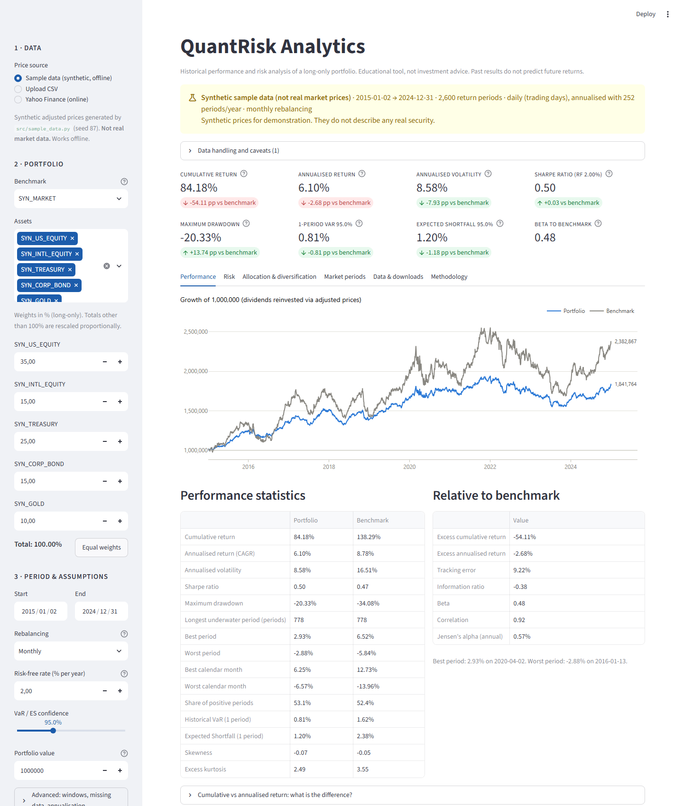
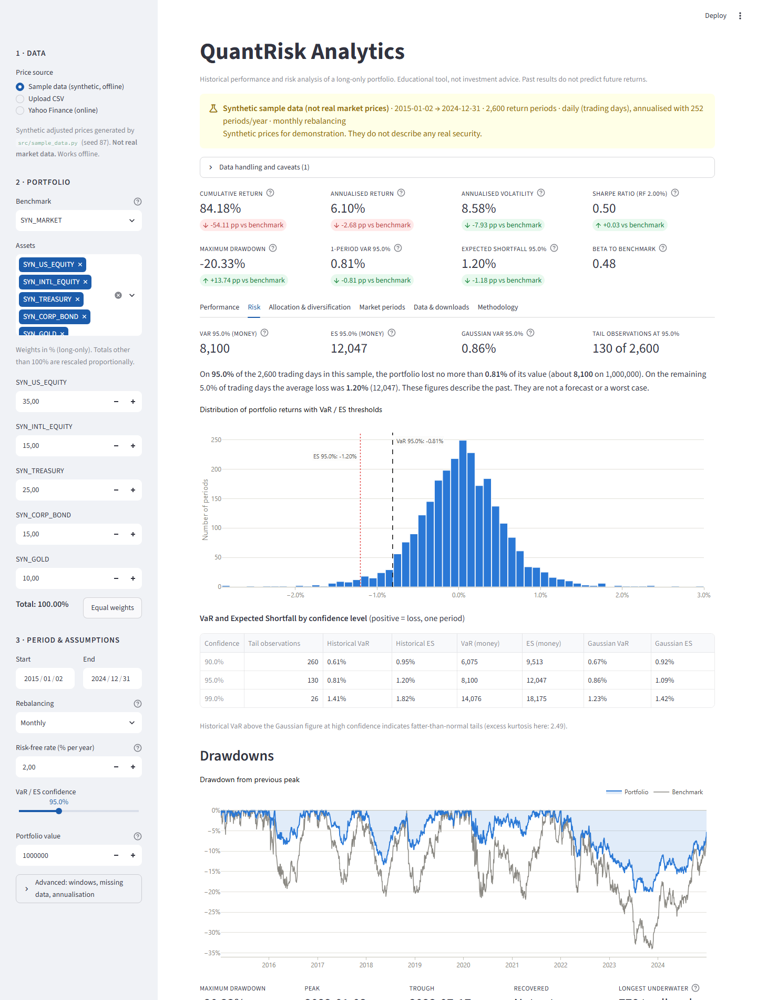
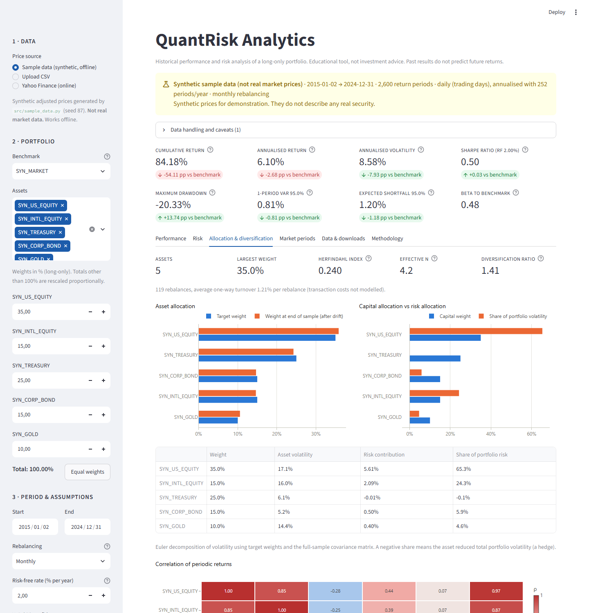

# QuantRisk Analytics

[](https://github.com/SaadBouadan/quant-risk-analytics/actions/workflows/tests.yml)


**Portfolio performance and risk analytics with documented methodology,
tested financial calculations and an interactive Streamlit dashboard.**

QuantRisk Analytics takes a set of assets and weights, builds the portfolio
under an explicit rebalancing rule and measures how it performed and how much
risk it took relative to a benchmark. That includes historical Value at Risk and
Expected Shortfall, drawdowns, rolling risk, correlations, risk contributions
and an out-of-sample VaR backtest. Every number is computed by a small, unit-tested
function in `src/`. The dashboard only displays results.

> **Disclaimer.** This is an educational analytics tool, not investment advice.
> All statistics describe a historical sample; they are not forecasts and do not
> guarantee future performance.

---

## Contents

- [Motivation](#motivation)
- [Key features](#key-features)
- [Screenshots](#screenshots)
- [Installation](#installation)
- [Running the app](#running-the-app)
- [Running the tests](#running-the-tests)
- [Input formats](#input-formats)
- [Methodology and formulas](#methodology-and-formulas)
- [Example analysis](#example-analysis)
- [Project structure](#project-structure)
- [Data sources and their limitations](#data-sources-and-their-limitations)
- [Known limitations](#known-limitations)
- [Deployment](#deployment)
- [Roadmap](#roadmap)

---

## Motivation

Many portfolio dashboards compute a Sharpe ratio on returns of unknown
frequency, annualise a few months of data, forward-fill missing prices without
saying so and show VaR with an ambiguous sign. This project aims to do the
basics **correctly and transparently**:

- every assumption (adjusted prices, 252-day year, rebalancing rule, risk-free
  convention, VaR quantile definition) is explicit, configurable where sensible,
  and documented;
- every calculation is a pure function verified against **hand-calculated**
  results;
- data problems are **reported, never hidden**.

## Key features

**Data**
- Three sources:
  - a bundled **synthetic sample dataset**, which works offline and is clearly labelled as non-market data;
  - **CSV upload**, in wide or long format, with a downloadable template;
  - optional **Yahoo Finance** download via `yfinance`.
- Strict validation of ISO dates, duplicates, non-numeric values and non-positive prices.
- An explicit missing-data policy (drop or bounded forward-fill) with a full data-quality report.
- Automatic frequency detection (daily / weekly / monthly / …) for correct annualisation.

**Portfolio construction**
- Long-only weights. Invalid inputs are rejected, and weights that don't sum to 100% are rescaled with a notice.
- Five rebalancing rules (daily, monthly, quarterly, annual, buy-and-hold) that drift weights between rebalances and report turnover.

**Performance**
- Cumulative and annualised (CAGR) return, annualised volatility, and Sharpe ratio with a configurable risk-free rate.
- Maximum drawdown with peak, trough and recovery dates, plus the longest underwater period.
- Best and worst period and calendar month, and a monthly returns table.
- Benchmark-relative statistics: excess return, tracking error, information ratio, beta, correlation and Jensen's alpha.

**Risk**
- Historical VaR and Expected Shortfall at any confidence level, as **positive loss** fractions and monetary amounts, with a Gaussian comparison.
- Rolling volatility and rolling Sharpe ratio on trailing windows only (no look-ahead).
- An **out-of-sample VaR backtest** with the Kupiec proportion-of-failures test.
- A correlation matrix, Herfindahl index, effective number of assets, diversification ratio and **Euler risk contributions**.

**Market-period analysis** (advanced feature)
- Calendar-year risk table.
- Portfolio behaviour in **Calm / Normal / Stressed** regimes, classified from the benchmark's *prior* volatility.

**Outputs**
- Downloads: portfolio returns, an analysis summary that includes all assumptions, the weights history and the aligned prices.
- An in-app methodology tab that renders [docs/METHODOLOGY.md](docs/METHODOLOGY.md) and live-checks a worked VaR example.

## Screenshots

> Screenshots below use the bundled **synthetic** dataset.

**Overview and performance.** Headline metrics with benchmark deltas, growth of the investment, and the statistics tables.



**Risk.** Historical VaR/ES in percent and money, return distribution, Gaussian comparison and drawdowns.



**Allocation and diversification.** Target vs drifted weights, capital vs risk allocation (Euler contributions) and correlations.



Each tab has a direct link, e.g. `http://localhost:8501/?tab=risk`
(`performance`, `risk`, `allocation`, `periods`, `data`, `methodology`).

## Installation

Requirements: **Python 3.10 or newer** (tested on 3.12; CI runs 3.11 and 3.12) and Git.

```bash
git clone https://github.com/SaadBouadan/quant-risk-analytics.git
cd quant-risk-analytics
python -m venv .venv
```

Activate the environment:

```bash
# Windows (PowerShell)
.venv\Scripts\Activate.ps1
# macOS / Linux
source .venv/bin/activate
```

Install dependencies:

```bash
pip install -r requirements.txt        # to run the app
pip install -r requirements-dev.txt    # to also run tests, lint and the notebook
```

No API keys or paid services are needed.

> **Windows note:** keep the project in a short path (e.g. `C:\dev\quant-risk-analytics`).
> `pyarrow`, which Streamlit uses to render tables, cannot load its DLLs from
> paths longer than 260 characters unless Windows long-path support is enabled.

## Running the app

```bash
streamlit run app.py
```

Then open http://localhost:8501. The app starts on the synthetic sample data, so
it works offline. In the sidebar:

1. **Data.** Choose sample data, upload a CSV or download prices from Yahoo Finance.
2. **Portfolio.** Pick a benchmark and the assets, and enter weights in percent.
3. **Period & assumptions.** Set the date range, rebalancing rule, risk-free rate,
   VaR confidence and portfolio value. The *Advanced* section holds the rolling
   windows, missing-data policy and annualisation override.

The exploratory notebook is in [`notebooks/exploratory_analysis.ipynb`](notebooks/exploratory_analysis.ipynb).

## Running the tests

```bash
pytest            # run the full suite
pytest -q tests/test_risk_metrics.py
ruff check .      # lint
```

There are **163 tests**:

| File | What is verified |
|---|---|
| `test_performance.py` | Compounding, CAGR, volatility, Sharpe with risk-free conversion, drawdown depth, dates and durations, relative metrics |
| `test_risk_metrics.py` | VaR/ES on hand-worked examples, the floating-point tail-count bug, a cross-check vs `numpy.quantile(method="inverted_cdf")`, ES ≥ VaR, Gaussian VaR/ES, absence of look-ahead in rolling metrics and the backtest, Kupiec test values, diversification statistics, regimes |
| `test_portfolio.py` | Weight validation and the rebalancing rules solved by hand (daily, monthly, quarterly, buy-and-hold) |
| `test_data_loader.py` | CSV parsing and rejection messages, the missing-data policies, frequency detection, sample-data reproducibility, the Yahoo adapter (stubbed, no network) |
| `test_analysis.py` | End-to-end consistency on the sample data |
| `test_app.py` | Headless Streamlit run: the app starts, KPIs match the analytics layer, and validation errors are displayed |

The expected values in the tests are worked out by hand in the test comments.
They are not copied from the code's own output.

## Input formats

**Wide CSV (recommended)**, the format of the downloadable template:

```csv
Date,TICKER_A,TICKER_B,BENCHMARK
2024-01-02,100.00,50.00,400.00
2024-01-03,101.25,49.80,402.10
```

**Long CSV:**

```csv
Date,Ticker,Adj Close
2024-01-02,TICKER_A,100.00
2024-01-02,TICKER_B,50.00
```

Rules:

- Dates must be ISO 8601 (`YYYY-MM-DD`). Ambiguous formats such as `03/04/2024` are rejected.
- Values must be **adjusted closing prices** (split- and dividend-adjusted) and strictly positive.
- Empty cells or `NA`, `N/A`, `null`, `#N/A` and `-` mean "missing". They are handled by the missing-data policy and never treated as zero.
- Any regular frequency works (daily, weekly, monthly, quarterly, annual). It is detected automatically.
- The long-format price column can be named `Adj Close`, `Adj_Close`, `Price` or `Close`, and the ticker column `Ticker` or `Symbol`.

## Methodology and formulas

The full specification is in **[docs/METHODOLOGY.md](docs/METHODOLOGY.md)**. A
plain-language Q&A is in **[docs/INTERVIEW_GUIDE.md](docs/INTERVIEW_GUIDE.md)**.
Key definitions, with $N$ return periods and $P$ periods per year (252 for daily data):

| Metric | Formula / convention |
|---|---|
| Simple return | $r_t = P_t / P_{t-1} - 1$ (from adjusted prices, so it approximates total return) |
| Cumulative return | $\prod_t (1 + r_t) - 1$ |
| Annualised return (CAGR) | $(1 + R_{\text{cum}})^{P/N} - 1$ |
| Annualised volatility | sample std. dev. $\times \sqrt{P}$ |
| Sharpe ratio | $\overline{(r - r_f)} / s(r - r_f) \times \sqrt{P}$, with $r_f = (1+r_f^{\text{annual}})^{1/P} - 1$ |
| Maximum drawdown | $\min_t (V_t / \max_{u\le t} V_u - 1)$, with the initial investment as the first peak |
| Historical VaR | $k = \lceil n(1-c) \rceil$; $\text{VaR} = -r_{(k)}$ (positive = loss, one period) |
| Expected Shortfall | $-\frac{1}{k}\sum_{j \le k} r_{(j)}$ (average of the *k* worst returns) |
| Tracking error / IR | $s(r_p - r_b)\sqrt{P}$ / $\overline{(r_p - r_b)}\,P$ ÷ TE |
| Beta | $\operatorname{cov}(r_p, r_b) / \operatorname{var}(r_b)$ |
| Risk contribution | $w_i (\Sigma w)_i / \sigma_p$ (sums to $\sigma_p$) |
| Diversification ratio | $\sum_i w_i \sigma_i / \sigma_p$ |

**Worked VaR example.** This is also a unit test and is live-checked in the app.
For 20 daily returns, the two worst are −3.0% and −2.2%. At 90% confidence,
$k = \lceil 20 \times 0.10 \rceil = 2$, so **VaR = 2.2%** and **ES = (3.0% + 2.2%)/2 = 2.6%**.
On a 1,000,000 portfolio that is a one-day VaR of 22,000 and an ES of 26,000.

**Cumulative vs annualised.** Doubling your money over 10 years is a cumulative
return of 100% but an annualised return of 7.18% ($2^{1/10}-1$). Annualised
figures from less than a year of data are flagged in the app.

## Example analysis

Default sample portfolio (**synthetic data**, 2015-01-02 → 2024-12-31, monthly
rebalancing, risk-free rate 2%):

- 35% `SYN_US_EQUITY`
- 15% `SYN_INTL_EQUITY`
- 25% `SYN_TREASURY`
- 15% `SYN_CORP_BOND`
- 10% `SYN_GOLD`

The benchmark is `SYN_MARKET`.

| | Portfolio | Benchmark |
|---|---|---|
| Cumulative return | 84.18% | 138.29% |
| Annualised return (CAGR) | 6.10% | 8.78% |
| Annualised volatility | 8.58% | 16.51% |
| Sharpe ratio | 0.50 | 0.47 |
| Maximum drawdown | −20.33% | −34.08% |
| 1-day historical VaR 95% | 0.81% | 1.62% |
| 1-day Expected Shortfall 95% | 1.20% | 2.38% |

How to read it:

- **Less return, much less risk.** The portfolio earned 2.7 percentage points a
  year less than the market, but with about half the volatility, a shallower
  drawdown and half the daily VaR. Its risk-adjusted return (Sharpe 0.50 vs
  0.47) was slightly better. Beta is 0.48.
- **Risk is not allocated the way capital is.** US equity is 35% of the capital
  but about **65% of the volatility**. Treasuries contribute roughly **0%** of
  the risk because they are negatively correlated with equities.
- **Fat tails.** Excess kurtosis is about 2.5. At 99% confidence, historical VaR
  (1.41%) exceeds Gaussian VaR (1.23%): a normal-distribution model would
  understate tail risk.
- **The backtest passes on frequency.** A rolling 252-day 95% VaR was breached on
  118 of 2,348 days (117.4 expected; Kupiec p = 0.95), between 9 and 17 times
  per full year. The Kupiec test checks frequency only, not whether breaches
  cluster in time.
- **Rebalancing matters.** Without rebalancing, the US-equity weight drifts from
  35% to 49% and volatility rises from 8.6% to 9.8% (see the notebook).
- **Regimes matter.** On *Stressed* days (4% of the sample), the portfolio's
  annualised volatility was 14.1%, against 8.3% on *Calm* days.

These figures come from a synthetic dataset and illustrate the methodology only.

## Project structure

```
quant-risk-analytics/
├── app.py                     # Streamlit UI (presentation only)
├── src/
│   ├── data_loader.py         # CSV/Yahoo loading, validation, alignment, missing data, frequency
│   ├── sample_data.py         # deterministic synthetic dataset generator
│   ├── portfolio.py           # weight validation, rebalancing simulation, turnover
│   ├── performance.py         # returns, CAGR, volatility, Sharpe, drawdowns, relative metrics
│   ├── risk_metrics.py        # VaR/ES, rolling risk, backtest, diversification, regimes
│   ├── analysis.py            # end-to-end pipeline + export tables (used by app, notebook, tests)
│   ├── charts.py              # Plotly figure builders (no analytics)
│   └── exceptions.py          # user-facing error types
├── tests/                     # pytest suite (163 tests)
├── data/
│   ├── sample_prices.csv      # synthetic prices (SYN_ tickers)
│   └── README.md
├── notebooks/exploratory_analysis.ipynb
├── docs/
│   ├── METHODOLOGY.md         # formal definitions (rendered in the app)
│   ├── INTERVIEW_GUIDE.md     # plain-language Q&A
│   └── screenshots/
├── .github/workflows/tests.yml  # CI: ruff + pytest on Python 3.11 / 3.12
├── .streamlit/config.toml
├── requirements.txt / requirements-dev.txt
├── pyproject.toml             # pytest + ruff configuration
└── LICENSE
```

## Data sources and their limitations

- **Synthetic sample.** Generated by `src/sample_data.py` (fixed seed) from a
  two-factor model with fat-tailed shocks and stylised stress regimes. It is
  **not market data**: all tickers carry a `SYN_` prefix and the app labels it
  on every page. It contains deliberate gaps (a late listing and holiday closures)
  to demonstrate the missing-data handling. See [data/README.md](data/README.md).
- **Yahoo Finance (optional).** Accessed through the open-source `yfinance`
  library, which uses Yahoo's public endpoints. It is **not an official API**.
  Access may be rate-limited, change without notice or fail. Data may contain
  errors, gaps or revised adjustments. Use is subject to Yahoo's terms of
  service, and the data is for personal and educational use. The app requests
  split- and dividend-adjusted closes (`auto_adjust=True`), treats the end date
  as inclusive and reports tickers that returned no data. If the download fails,
  use the sample data or a CSV.
- **Uploaded files.** The user is responsible for supplying adjusted prices and
  for having the right to use the data.

## Known limitations

- Historical statistics depend entirely on the chosen sample. Historical VaR cannot anticipate events worse than those in the data.
- Statistics such as VaR and the Sharpe ratio are reported as point estimates, without confidence intervals.
- Only long-only portfolios are supported. There is no leverage, shorting or cash position.
- Transaction costs, taxes, slippage and FX conversion are ignored. Multi-currency assets are treated in their own quote currencies.
- The risk-free rate is constant over the sample.
- VaR and ES are one-period figures. There is no multi-day horizon scaling.
- Risk contributions use full-sample covariance and target weights. They are approximate for drifting portfolios.
- The Kupiec test checks the frequency of VaR breaches, not their independence.
- Volatility regime thresholds (15% / 25%) are fixed conventions, not estimated.

## Deployment

**Streamlit Community Cloud (free):**

1. Push the repository to GitHub.
2. At [share.streamlit.io](https://share.streamlit.io), click **New app** and select the repository, branch `main` and file `app.py`.
3. Under *Advanced settings*, choose Python 3.11 or 3.12. `requirements.txt` is installed automatically.

No secrets are required. The sample data ships with the repository, so the
deployed app works even if Yahoo Finance is unreachable from the server.

**Local or any server:** `streamlit run app.py --server.port 8501 --server.address 0.0.0.0`.

## Roadmap

- [ ] EWMA / filtered historical simulation VaR, so recent volatility carries more weight
- [ ] Christoffersen independence test, alongside Kupiec
- [ ] Transaction-cost model applied to rebalancing turnover
- [ ] Time-varying risk-free rate (e.g. a T-bill series upload)
- [ ] Historical stress scenarios (replay a chosen window on today's weights)
- [ ] Bootstrap confidence intervals for the Sharpe ratio and VaR
- [ ] Multi-currency support with FX conversion to a base currency
- [ ] Export of a PDF factsheet

## License

[MIT](LICENSE)
